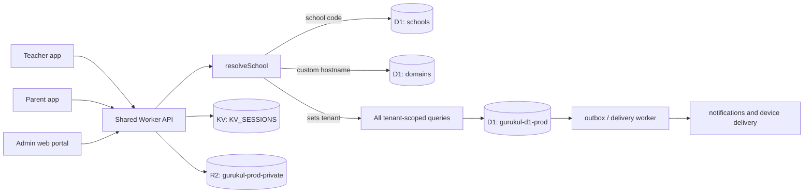
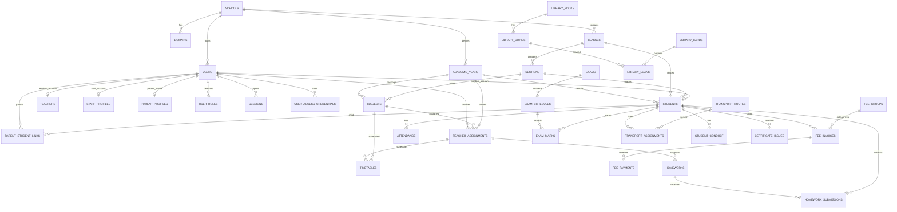

# Gurukull Cloudflare database architecture

The current live mobile API is a shared Cloudflare Worker backed by the D1
binding DB (gurukul-d1-prod). Schools are rows in schools; the rest of the
records carry school_id. R2 stores private files and KV stores session/cache
data.

## Request and tenant flow

The mobile apps use the school-code branch. A custom domain can use the
hostname branch when that hostname exists in domains. The Worker rejects a
missing code, an unknown code, or a code that disagrees with the mapped domain.

## Core entity relationships

## Table inventory by area

**Tenant and identity:** schools, domains, users, sessions, devices,
user_profiles, user_roles, user_access_credentials, parent_profiles,
staff_profiles, students, teachers, parent_student_links.

**Academics:** academic_years, classes, sections, subjects,
teacher_assignments, timetables, timetable_configuration,
timetable_archives, school_configuration.

**Learning and communication:** homeworks, homework_submissions,
lesson_plans, notices, attendance, attendance_batches, absent_reasons,
exams, exam_schedules, exam_marks, exam_grade_bands, school_quizzes,
school_quiz_attempts, quiz_review_history, student_conduct,
conduct_parent_reads, school_live_classes, live_class_link_launches.

**Finance and people operations:** fee_groups, fee_invoices, fee_payments,
finance_policy, fee_ledger_entries, leave_types, staff_leaves,
payroll_templates, payroll_structures, payroll_payslips, payroll_payments.

**Operations:** library_categories, library_books, library_copies,
library_cards, library_loans, inventory_categories, inventory_suppliers,
inventory_items, inventory_transactions, visitor_logs, transport_vehicles,
transport_routes, transport_stops, transport_assignments.

**Lifecycle and documents:** student_lifecycle, alumni_profiles,
certificate_templates, certificate_issues, files.

**Reliability, audit, and delivery:** outbox, changelog, command_idempotency,
mutation_commands, command_guards, audit_events, delivery_outcomes,
upload_reservations, storage_limits, provisioning_operations,
login_attempts, administrator enrollment tables, and access-key tables.

## Isolation rule

Every school-owned table includes school_id, and API queries bind the
authenticated user's school_id in their WHERE clauses. Composite foreign keys
and SQLite triggers reject relationships that mix schools. The shared D1
database therefore provides infrastructure sharing while preserving tenant
data isolation.
